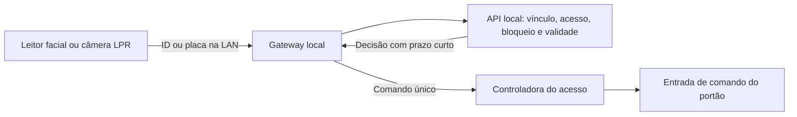

# Facial, placas e abertura de portões

## Situação real da entrega

Há código para receber identificação, conferir a autorização no servidor local e comandar controladoras por protocolos específicos. A abertura física permanece desligada na instalação nova. **Nenhum modelo foi testado em bancada ou condomínio nesta entrega.** A lista abaixo representa caminhos implementados e famílias para avaliação, sem certificação de todos os modelos ou afirmação de participação de mercado.

Os ensaios automatizados usam os adaptadores reais com transportes simulados e a API/SQLite locais. Eles verificam validade, cancelamento, vínculo facial, placa, isolamento, eventos repetidos e comandos incertos. Não comprovam fiação, qualidade do reconhecimento, compatibilidade do firmware, intertravamento nem movimento real do portão.

## Caminhos disponíveis

| Equipamento/família para avaliar | Identificação | Comando | Condição |
| --- | --- | --- | --- |
| Control iD iDFace / iDFace Max | Callback Pro new_user_identified | Resposta online door ou sec_box; abertura remota API | Identificador facial confirmado, portal correto, cadastro biométrico e contingência revisada |
| Intelbras SS com HTTP API (exemplos SS 1530/3532/5532/7532 MF W) | CGI AccessControl, exclusivamente Method 15, UserID, RecNo e UTC | Controladora independente | Confirmar campos na versão instalada; relé do leitor isolado do portão |
| Intelbras VIP LPR (famílias 5460, 74120 e 99300) | TrafficJunction com placa, RecNo e UTC | Controladora vinculada | Confirmar contrato do modelo e desligar abertura automática nativa |
| Hikvision MinMoe com ISAPI (famílias DS-K1T320/342/673) | AccessControllerEvent 5/75 com employeeNoString, serialNo, doorNo e dateTime | Controladora independente | ISAPI habilitado, formato de evento confirmado e relé do leitor isolado |
| Hikvision ANPR ISAPI (série 7, TCM/TCG nas versões compatíveis) | ANPR XML/JSON com licensePlate e horário com fuso | Controladora vinculada | Canal correto e abertura nativa desligada |
| Hikvision controladoras ISAPI | Não realiza reconhecimento pelo conector de atuação | RemoteControlDoor com Digest | Confirmar capacidades e porta; resposta XML statusCode 1 é aceite lógico |
| Intelbras controladoras CGI | Não realiza reconhecimento pelo conector de atuação | accessControl.cgi/openDoor com Digest | Confirmar canal e contrato HTTP API |
| Dahua com contrato CGI compatível | AccessControl facial Method 15 ou TrafficJunction | CGI em controladora independente | Somente firmware que documente esse contrato; DSS/ITSAPI não são equivalentes |
| ZKTeco SpeedFace/ProFace X por ZKBio CVSecurity | Reconhecimento nativo preventivo **não implementado** neste caminho | remoteOpenById no servidor CVSecurity | API/licença, doorId e servidor local. Para integrar identificação à decisão Imperium, precisa de produtor SDK homologado |
| Hikvision HCNetSDK | Coleta facial/ANPR via SDK não incluída | Helper C++ ControlGateway | Obter SDK, compilar para a arquitetura e homologar |
| Dahua DSS | Depende de pacote oficial | Contrato para ponte licenciada | A implementação nativa dessa ponte continua pendente |
| Outros SDKs/controladores | Produtor homologado envia evento HMAC | Uma das controladoras implementadas | Não representa compatibilidade nativa automática com qualquer aparelho |

Os sufixos de produto e as versões importam. Suporte a câmera, ONVIF S/G/T, RTSP ou uma interface web não prova suporte à autorização de acesso. Um motor de portão normalmente recebe o pulso de uma controladora/relé; a marca do motor, isoladamente, não define uma API.

## Duas montagens suportadas pelo código

**Control iD Pro:** o leitor reconhece localmente e consulta a central na LAN antes de receber a ação. A central associa o ID externo ao cadastro Imperium e confere validade, bloqueio e acesso. O identifier_id precisa constar em faceIdentifierIds; cartão, PIN ou outro mecanismo não pode assumir um vínculo facial.

**Leitor/câmera e controladora separados:** o leitor reconhece a pessoa ou a câmera lê a placa; a central consulta a autorização e envia um pulso à controladora vinculada. Para facial por evento, o relé do leitor precisa estar fisicamente isolado do portão. Configurar readerRelayIsolated, nativeAutomaticOpeningDisabled e recognitionMode somente após esse ensaio. Um evento de passagem ou abertura já ocorrida não vira uma autorização preventiva do mesmo relé.



O cadastro facial fica no equipamento ou no software oficial. O Imperium não cria templates, executa reconhecimento em fotos no navegador nem distribui automaticamente biometrias entre marcas. Um cadastro do visitante pode manter o mesmo ID ao renovar a validade; coincidência de nomes não transfere face.

## Cadastro assistido no Windows

1. Instalar e iniciar a central conforme [LOCAL.md](./LOCAL.md). Criar administrador e moradores com unidades.
2. Executar `local\Cadastrar-Equipamento.cmd`, mantendo a central ativa. O assistente usa login de administrador e a API local; senhas de aparelhos ficam somente no diretório privado.
3. Para montagem separada, cadastrar **primeiro a controladora**. Informar nome, modelo, firmware, acesso, endereço local, credencial e canal reais. Ela nasce desativada e não homologada.
4. Cadastrar o leitor ou câmera. Selecionar sua família/protocolo e a controladora do mesmo acesso. No Control iD, informar device_id, portal_id, ação e identifier_id facial confirmado.
5. Reiniciar a central para carregar a configuração. Executar `local\Verificar-Equipamentos.cmd`. A verificação consulta identidade/capacidades e autenticação; **não manda abertura**, não configura relés e não marca homologação.
6. O integrador configura o próprio leitor/câmera: IP e horário, cadastro facial, notificações/eventos e isolamento do comando nativo. Os detalhes elétricos e a pinagem seguem os manuais exatos dos aparelhos e do motor. O procedimento por fabricante está em [IMPLANTACAO.md](./IMPLANTACAO.md).
7. No painel, criar a credencial com unidade, validade, acessos e placa/referência facial. Em Vínculo facial, associar o ID do usuário no leitor ao ID dessa credencial. Para placa, conferir a grafia cadastrada; não há busca por placa parecida.
8. Concluir os testes locais de cada aparelho com o instalador. Executar `local\Comissionar-Equipamento.cmd` para registrar o aceite e habilitar os dois lados. Ele solicita confirmação do ensaio e das condições físicas; **não executa um teste de abertura por conta própria**. Homologar a controladora antes do leitor/câmera.
9. Reiniciar a central. Em janela supervisionada, fazer o ensaio integrado dos cenários abaixo. Só então usar com moradores reais.

No Linux, executar os mesmos assistentes `.mjs` com Node 24 no diretório da instalação e sob o usuário de manutenção apropriado. Os `.cmd` são atalhos Windows; o gateway não depende do Windows.

O perfil escolhido no painel orienta o cadastro e mostra suas condições. O assistente local também escreve a configuração privada; cadastrar apenas no painel não instala o SDK nem configura a rede/aparelho.

## Configuração privada: exemplos de ligação lógica

Exemplo de leitor Hikvision usado como identificador, com controladora separada. Endereços e IDs são ilustrativos. As proteções começam desligadas e não devem ser alteradas sem o ensaio físico:

```json
{
 "id":"leitor-social",
 "provider":"hikvision",
 "protocol":"hikvision-isapi",
 "model":"PREENCHER_MODELO_REAL",
 "firmware":"PREENCHER_VERSAO_REAL",
 "gate":"social",
 "baseUrl":"http://192.168.50.20",
 "sourceIp":"192.168.50.20",
 "usernameEnv":"HIK_USERNAME",
 "passwordEnv":"HIK_PASSWORD",
 "channel":1,
 "watchEvents":true,
 "actuatorId":"controladora-social",
 "recognitionMode":"audit",
 "readerRelayIsolated":false,
 "nativeAutomaticOpeningDisabled":false,
 "enabled":false,
 "commissioned":false
}
```

A API deve ter o mesmo identificador, gateway, acesso e actuatorId. A controladora também precisa existir nos dois lados. O código recusa divergência de acesso, origem, canal ou controladora.

Para plate-reader, usar o perfil da câmera, o canal do evento e nativeAutomaticOpeningDisabled. Hikvision usa canal do evento conforme o firmware, normalmente baseado em 1; CGI usa index normalmente baseado em 0. Não converter automaticamente esses números.

O runtime requer `physicalEnabled: true`, `IMPERIUM_ENABLE_PHYSICAL=yes`, dispositivo/central habilitados e homologados na API e dispositivo habilitado/homologado no arquivo privado. Os assistentes fazem essa passagem somente após o aceite indicado pelo responsável.

## Recebimento de eventos e origem

- Control iD: prefixo `http://IP_DA_CENTRAL:8765/callbacks/ID`. Implementados new_user_identified.fcgi, device_is_alive.fcgi e session_is_valid.fcgi. Somente o sourceIp do aparelho pode usar o prefixo. Os endpoints de disponibilidade exigem contato recente com a autoridade; a contingência nativa do fabricante ainda precisa ser validada.
- Hikvision: conexão Digest a `/ISAPI/Event/notification/alertStream` com reconexão. Alternativa HTTP Listening: POST XML/JSON ou multipart para `/callbacks/ID/events`, somente do sourceIp configurado. Não ativar pull e push simultaneamente sem verificar os IDs/deduplicação no modelo.
- Intelbras/Dahua CGI: eventManager attach com reconexão, AccessControl e TrafficJunction. Imagens são descartadas. Metadados sem ID estável, horário válido ou campos obrigatórios são ignorados.
- Produtor SDK: POST JSON para `/callbacks/ID/recognition`, com protocolo signed-events e chave própria em eventSecretEnv. A origem também precisa ser sourceIp. Biblioteca de envio em `gateway/sdk-producer.mjs`.

A porta de callbacks deve ser restrita aos IPs dos equipamentos/produtores, em segmento privado. Não publicar na internet. O cadastro assistido prepara callbackListen quando necessário. No Windows, após conferir os IPs, executar `local\Configurar-Callbacks.ps1` como administrador: libera somente sourceIp dos dispositivos de callback, na porta/endereço configurados e no perfil Privado. No Linux, aplicar regra equivalente. O script de HTTPS da interface não abre essa porta automaticamente.

O evento assinado contém **somente**:

```json
{"eventId":"ID_ESTAVEL_DO_SDK","method":"face","identifier":"ID_NO_LEITOR","occurredAt":"2026-10-24T12:00:00.000Z"}
```

Cabeçalho `X-Imperium-Signature`: HMAC-SHA256 hexadecimal usando a chave exclusiva do dispositivo sobre `POST`, quebra de linha, `/callbacks/ID/recognition`, quebra de linha e o JSON original. Não enviar imagem, nome ou URL de atuação. O produtor precisa confirmar reconhecimento real; detecção de rosto, proximidade ou evento de ponto não são equivalentes a identificação facial.

## Decisão, repetição e registro

O horário da autorização é o da central. Eventos de reconhecimento precisam estar recentes (até cinco segundos, tolerância futura de dois segundos); relógios devem estar alinhados. A decisão expira em até quatro segundos e nunca depois da validade da credencial. Sem resposta da autoridade, não há novo comando.

Evento duplicado não recebe nova autorização. O diário SQLite é gravado antes da atuação. Há uma janela persistente por acesso para evitar pulsos simultâneos vindos de fontes diferentes, por padrão cinco segundos; actuationCooldownMs pode ser definido pelo integrador entre 1.000 e 30.000 ms. Essa janela **não substitui intertravamento elétrico nem sensor**.

Timeout ou resposta ambígua permanece indeterminado, sem reenvio automático do comando. Aceite do fabricante não confirma que a folha/cancela se moveu. A portaria vê as decisões recebidas em Identificações recebidas; resultados do transporte ficam no diário privado do gateway.

Não apagar o banco ou o diário para tentar novamente. Um novo comando manual precisa de conferência do operador e motivo identificado.

## Aceite obrigatório no condomínio

Registrar marca/modelo/firmware, perfil, IP, canal, ligação e responsáveis. Testar face/placa válida, desconhecida, futura, vencida, revogada e de outro acesso; homônimos; renovação da visita sem troca de identidade; repetição do evento; leitura sucessiva; perda de resposta; reinício e restauração de backup isolada.

Desligar **a WAN/internet**, mantendo LAN, energia e central ligados, e repetir os fluxos. Depois testar perda da LAN/central separadamente e conferir que o leitor não ignora o bloqueio por uma autorização local própria. Fora da LAN, o morador não acessa a instalação exclusivamente local por 4G.

O piloto não deve substituir o sistema vigente até o aceite real. SDKs/licenças, versões não documentadas, fiação e equipamentos ausentes não podem ser resolvidos apenas por software ou por uma lista de marcas.

## Fontes oficiais e limites de aplicação

- [Control iD: eventos de identificação](https://www.controlid.com.br/docs/access-api-pt/modos-de-operacao/eventos-de-identificacao-online/) e [modo online](https://www.controlid.com.br/docs/access-api-pt/modos-de-operacao/configurar-modo-online/).
- [Intelbras: HTTP API V3.35](https://botminio.apps.intelbras.com.br/sdk-api/HTTP%20API%20V3.35_Intelbras.pdf), especialmente AccessControl Method 15, openDoor e getCaps. A disponibilidade depende do produto/firmware.
- [Hikvision: capacidades ISAPI](https://tpp.hikvision.com/tpp/OpenCapabilities), [integração](https://tpp.hikvision.com/tpp/IntegrationCenter) e [evento SDK de face 0x4b](https://open.hikvision.com/hardware/structures/NET_DVR_ACS_ALARM_INFO.html). Obter a documentação ISAPI específica no TPP para confirmar os campos do modelo; não inclui aceite de MLA ou SDK proprietário.
- [Hikvision: ANPR série 7](https://www.hikvisioneurope.com/eu/portal/portal/Technology%20Partner%20Program/02-Solutioins%20of%20Hikvision%20product%20integration/ANPR%20Camera%20Integration%20Solution%20for%207%20series.pdf).
- [ZKTeco: API CVSecurity V1.1](https://s3.ap-southeast-1.amazonaws.com/zkteco.co.th/files/20240807/ZKBio_CVSecurity_3rd_Party_API_User_Manual_V1.1_20240521.pdf). A API de abertura e a de monitoramento não constituem, por si, callback facial preventivo.
- [Dahua: integração DSS](https://www.dahuasecurity.com/products/software/ecosystem/integration-with-dss). Confirmar contrato CGI com DEPP para a linha usada; o adaptador CGI não comprova suporte de qualquer terminal Dahua.
