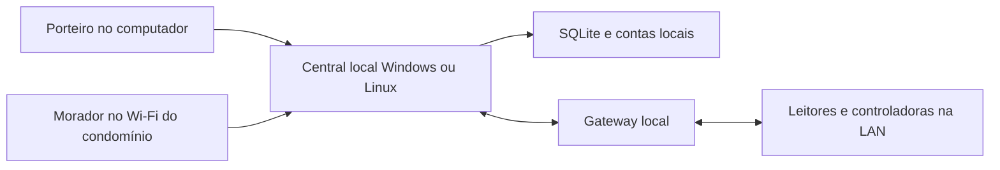

# Imperium — instalação local, sem internet na operação

## O que muda

Na instalação local, **site, autenticação, cadastros, banco, validade de visitas e decisões de acesso ficam no computador do condomínio**. A central conversa com os leitores e controladoras pela rede local. Não chama Oracle, Supabase, Google Fonts ou GitHub para executar esses fluxos.

O mesmo código pode ser instalado no Windows e em um servidor Linux da Imperium. Para continuar funcionando com a internet desligada, a instância que autoriza os equipamentos precisa estar **dentro da rede do condomínio**. Um servidor da Imperium fora do local pode ser usado para testes ou acesso remoto quando houver conexão; não substitui o computador local durante uma queda.

**Não há sincronização automática entre dois bancos independentes.** Não executar duas instâncias apontadas para os mesmos equipamentos nem restaurar uma cópia antiga para recuperar uma autorização: isso pode reativar credenciais canceladas. A central do condomínio é a autoridade da operação. Compartilhar o mesmo arquivo SQLite por pasta de rede também não é suportado.



O Wi-Fi e a rede cabeada continuam necessários, mesmo sem acesso à internet. Morador fora dessa rede não acessa a central local pelo 4G; essa é a consequência do funcionamento exclusivamente local. Não há notificação por WhatsApp, e-mail ou push externo nesta versão. Os painéis mostram as pendências enquanto estão abertos e conectados à central.

## Testes gratuitos e situação da entrega

A demonstração online continua no [GitHub Pages](https://horizes.github.io/controle-acesso/), e a API de testes existente continua no Supabase Free. Não é necessário contratar VPS nem cadastrar cartão na Oracle para esses testes. Os planos gratuitos têm limites; o [Supabase Free](https://supabase.com/pricing) pode pausar após uma semana sem atividade. Esses serviços **não participam da decisão da instalação local** e não recebem automaticamente seus cadastros.

O pacote Windows inclui Node.js 24, a interface construída, fontes locais, API, SQLite e gateway. A instalação pronta não executa npm, não baixa bibliotecas e não faz login na nuvem. As ferramentas de build são necessárias apenas para quem altera o código-fonte.

Teste local do software feito no Windows, sem chamadas externas permitidas. Scripts de certificado, firewall e inicialização foram conferidos quanto à sintaxe, mas precisam ser executados e validados **no computador definitivo**. Não houve instalação naquele equipamento nem homologação de leitor, câmera ou portão. A conferência visual da instância local pelo navegador não foi concluída porque o ambiente de execução não permitiu a conexão entre os processos; o teste HTTP real dentro do processo de testes passou. Acesso entre dispositivos da LAN, confiança HTTPS, inicialização automática e aparelhos exigem o aceite no local.

## 1. Preparar o computador e a rede

1. Separar um computador Windows 10/11 x64 compatível com Node 24, ou um servidor Linux com Node 24 já instalado. Para um primeiro piloto, reservar 4 GB de RAM, SSD com espaço para histórico e backup e rede cabeada. Dimensionar após medir a operação; não há quantidade máxima de condomínios homologada.
2. Definir um endereço IPv4 fixo/reservado do servidor na rede do condomínio, por exemplo `192.168.50.2`. **É um exemplo:** usar a rede real, sem conflito com outro aparelho. O endereço não deve mudar após emitir o certificado.
3. Colocar controladoras e leitores em rede separada/segmentada conforme o projeto. Permitir o acesso da central somente aos endereços/portas dos aparelhos. Não abrir portas no roteador para a internet.
4. Manter computador, switch, leitores e controladoras ligados. Desativar suspensão automática do computador durante a operação. Energia, disco, relógio e rede locais passam a ser dependências essenciais.
5. Instalar em uma pasta protegida, como `C:\Imperium\ControleAcesso`, com permissão de alteração apenas para os responsáveis pela manutenção. Não usar pasta pública, sincronizada ou compartilhamento de rede para o banco.

## 2. Primeiro acesso no Windows

1. Extrair o pacote **Imperium-Local-Windows.zip** na pasta escolhida. Manter `runtime`, `local`, `gateway` e os demais arquivos juntos.
2. Executar `local\Iniciar-Imperium.cmd`.
3. No primeiro início, preencher nome do condomínio, administrador, e-mail identificador e uma **nova senha local com pelo menos 12 caracteres**. A senha não aparece no terminal. Não existe senha administrativa padrão; as senhas públicas da demonstração não entram nesta instalação.
4. O programa cria `private\imperium.sqlite`, o gateway local e arquivos privados. Equipamentos ainda estão vazios e acionamento físico está desligado. Nenhuma conta ou senha do Supabase é alterada.
5. No próprio computador, abrir `http://127.0.0.1:8787/#portaria` e entrar com a conta recém-criada. Esse HTTP só fica disponível no próprio computador; os demais aparelhos precisarão do HTTPS da próxima etapa.
6. Em **Leitores e acessos → Administração → Usuário**, criar os porteiros e moradores. Informar nome, e-mail identificador, senha inicial, perfil e unidade. Não há confirmação por e-mail. Cadastrar ao menos um morador antes de registrar visitas/encomendas para sua unidade.
7. Contas podem ser ativadas/desativadas na lista. Desativar encerra suas sessões. A senha pode ser trocada presencialmente pelo operador de manutenção com `runtime\node.exe local\manage.mjs reset-password`; o comando é privado e encerra as sessões do usuário.

O administrador entra pela portaria com seu perfil administrativo. Porteiros e moradores usam contas próprias. O banco não inclui pessoas fictícias na instalação nova.

## 3. Abrir na rede local com HTTPS

O navegador precisa confiar no certificado local para login seguro e recursos de aplicativo. Não ignorar avisos de certificado. A instalação não precisa obter certificado pela internet: o script usa os recursos de certificado do Windows.

1. Parar a execução manual com `Ctrl+C` antes de alterar a configuração.
2. Abrir PowerShell na pasta da instalação e executar, usando o IPv4 real:

```powershell
.\local\Configurar-Rede.ps1 -ServerIPv4 192.168.50.2
```

Se a política do computador bloquear scripts, o administrador deve revisar e autorizar o arquivo conforme a política da empresa. Não desabilitar a proteção global do Windows.

3. O script cria uma autoridade local e um certificado HTTPS, protege a pasta privada e configura a porta 8443. **Não instala confiança automaticamente**. A chave da autoridade fica no repositório de certificados do usuário responsável; o PFX do servidor e sua senha ficam na pasta privada.
4. Conferir a impressão digital exibida. Instalar somente o certificado público `private\Imperium-CA.cer` como autoridade confiável nos computadores/celulares autorizados, conforme a política de cada dispositivo. Android/iOS podem exigir um passo adicional para habilitar confiança no certificado instalado. Nunca distribuir `server.pfx`, a senha dele, o banco ou os arquivos de gateway.
5. Reiniciar `Iniciar-Imperium.cmd`. No próprio computador, abrir `https://127.0.0.1:8443/#portaria`. Nos dispositivos da rede, abrir `https://192.168.50.2:8443/#portaria` ou `#morador`.
6. Conferir que a conexão é HTTPS confiável. Para adicionar o morador à tela inicial do celular, abrir pelo Wi-Fi da rede que tenha permissão para alcançar a central. Mesmo instalado como atalho/aplicativo, ele continua dependendo da central e da LAN.

O certificado do servidor dura dois anos no perfil inicial. Registrar a data e planejar renovação antes de vencer. Mudança de IP ou perda do perfil/certificado da autoridade exige manutenção. Uma PKI corporativa existente pode fornecer o PFX/PEM em vez dessa autoridade local; a configuração do Node aceita ambos.

## 4. Iniciar com o Windows

Depois de validar o acesso HTTPS, executar o script abaixo como administrador:

```powershell
.\local\Instalar-Inicializacao.ps1
```

Ele cria a tarefa `Imperium-Local` na inicialização, com a conta de serviço local sem privilégios administrativos, e permite a porta HTTPS somente da sub-rede local no perfil de rede **Privado**. A tarefa não exige usuário conectado. O código fica com permissão de leitura e o diretório privado com permissão de gravação para o serviço.

Parar a execução manual antes de iniciar a tarefa, para evitar porta/banco duplicados:

```powershell
Start-ScheduledTask -TaskName Imperium-Local
Get-ScheduledTaskInfo -TaskName Imperium-Local
```

Reiniciar o computador e testar novamente sem fazer login no Windows. Confirmar que API, painéis e gateway voltam. Conferir o histórico da tarefa se falhar. Uma reinicialização ou atualização do Windows interrompe a operação até o retorno do serviço; programar manutenção com a portaria.

## 5. Instalar no servidor Linux da Imperium

O pacote **Imperium-Local-Servidor.zip** contém o mesmo código e interface, sem executável Windows. Não é uma réplica sincronizada do banco Windows.

1. Copiar para `/opt/imperium/controle-acesso` em um servidor da rede local. Instalar previamente um runtime Node.js 24 oficial em `/opt/imperium/node`; o pacote não executa instalação pela internet.
2. Criar usuário de serviço `imperium`, sem login administrativo. Deixar código somente para leitura e `private` com gravação apenas desse usuário.
3. Executar `/opt/imperium/node/bin/node local/manage.mjs init` como esse usuário para criar uma instalação independente.
4. Para operar em rede, fornecer certificado HTTPS da PKI local e os arquivos de chave/certificado com acesso apenas ao serviço. No `private/config.private.json`, usar `tls: {"key":"server.key","cert":"server.crt"}`, `listenHost:"0.0.0.0"`, porta 8443 e `origins` com os endereços HTTPS privados permitidos. No gateway, usar `https://127.0.0.1:8443/api` e fornecer a autoridade pública via `gateway.ca`.
5. Instalar o exemplo `local/imperium-local.service.example` em `/etc/systemd/system/imperium-local.service`, conferir caminhos e permissões, executar `systemctl daemon-reload` e `systemctl enable --now imperium-local`.
6. Liberar HTTPS somente da rede local no firewall. Não usar procedimentos UFW em imagens OCI sem preservar as regras do provedor. Um servidor fora do condomínio **não mantém a ligação física funcionando sem internet**: para esse caso, deixar a central operacional no Windows local.

O servidor da Imperium pode hospedar testes, documentação e cópias privadas de backup. Sincronização automática, administração remota via túnel e recuperação automática entre dois servidores **não foram implementadas**; não são necessárias para a operação local entregue. A versão online existente é um ambiente separado.

## 6. Conectar leitores, placas e portões na LAN

Usar os procedimentos por fabricante em `IMPLANTACAO.md` e os perfis em `gateway/installation`. A diferença é a rede: apontar para os IPs locais dos equipamentos, sem VPN ou servidor na nuvem no caminho.

1. Em `private/gateway.private.json`, cadastrar o modelo, IP, porta e identificador de cada aparelho. O `id` deve ser o mesmo do cadastro em **Leitores e acessos**. Usar os arquivos de exemplo como referência, não copiar endereços fictícios para a operação.
2. Guardar usuário/senha/token de fabricante como variáveis no arquivo JSON `private/gateway-secrets.private.json`, por exemplo `CID_USERNAME` e `CID_PASSWORD`. O arquivo só pode ser lido pelo serviço e manutenção. Não colocar credenciais no navegador ou GitHub.
3. Na API local, cadastrar o dispositivo, seu protocolo, acesso e forma de identificação. Ele nasce desativado e não homologado. O gateway inicial já foi criado; seu token não é mostrado no painel e fica apenas no diretório privado.
4. Para Control iD Pro, cadastrar a face no leitor e associar seu ID à credencial local em **Vínculo facial**. Configurar callbacks para o IP da central na LAN. Ao habilitar `callbackListen`, escutar no endereço privado, porta 8765, e permitir no firewall apenas os IPs dos leitores autorizados. Não abrir essa porta para todos os moradores nem para a internet.
5. Para leitura de placa Intelbras compatível, usar a controladora vinculada, eventos documentados e desativar a abertura nativa automática no teste preventivo. Homologar o evento, horário, placa e vínculo com o acesso. A câmera identifica a placa; a central local confere validade e permissão.
6. Hikvision tem caminho direto ISAPI nas versões compatíveis e alternativa HCNetSDK; ZKTeco exige servidor/API licenciados na própria rede; Dahua tem caminho CGI condicionado ao modelo e alternativa DSS cuja ponte nativa ainda depende de implementação. Instalação local não elimina licenças nem torna todas as marcas/modelos compatíveis.
7. Depois do teste presencial, habilitar separadamente na API o gateway/dispositivo homologado e, na configuração privada, o dispositivo e `physicalEnabled:true`, com `IMPERIUM_ENABLE_PHYSICAL:"yes"`. Antes disso, permanece sem acionamento físico.

O termo “online” em protocolos de fabricante significa consultar a central local; não exige internet. Entretanto, o leitor/controladora deve ter suporte ao modo consultado no modelo/firmware real. O software não reconhece rostos em fotos pelo navegador nem cadastra biometria no aparelho automaticamente.

Renovações selecionam o **cadastro anterior por identificador e unidade**, preservando o vínculo facial. Digitar um nome igual não herda biometria. Chegadas avulsas autorizadas pela portaria recebem uma autorização própria; não vinculam uma face só por coincidência de nome.

### Assistentes de equipamentos

O pacote inclui `local\Cadastrar-Equipamento.cmd`, `local\Verificar-Equipamentos.cmd` e `local\Comissionar-Equipamento.cmd`. O cadastro pede login de administrador, prepara o registro na API e a configuração privada desativada. Cadastrar a controladora antes do leitor/câmera quando a montagem for separada. A verificação lê capacidades e autenticação, sem abertura. O comissionamento só é utilizado pelo responsável após o ensaio físico; não testa um portão sozinho.

Os mesmos programas `.mjs` funcionam com Node 24 no servidor Linux. O [guia de compatibilidade](./COMPATIBILIDADE.md) descreve os perfis, os campos de identificação e os limites. No Control iD, informar faceIdentifierIds com o mecanismo facial confirmado. Em facial Intelbras/Hikvision/Dahua por eventos, o relé do leitor fica isolado e a atuação ocorre por controladora independente; deixar o perfil em auditoria até comprovar essa montagem.

## 7. Testar sem internet antes do aceite

1. Conferir data/hora do servidor e dos aparelhos. A validade é decidida pelo relógio da central. Se o relógio local retroceder de forma relevante, a API bloqueia operações até a conferência de data/hora; não adiantar/atrasar para tentar recuperar autorizações vencidas.
2. Desconectar **a internet/WAN**, conservando roteador, switch e Wi-Fi locais. Abrir a central novamente, sem depender de aba já carregada.
3. Entrar com administrador, porteiro e dois moradores; conferir separação das unidades. Criar e cancelar visita, registrar/retirar encomenda e confirmar persistência após reiniciar.
4. Com instalação física supervisionada, testar pessoa/placa autorizada, desconhecida, bloqueada, antes do início e depois do vencimento. Repetir um evento e confirmar que não causa um segundo comando. Conferir que uma liberação com resultado indeterminado não é reenviada automaticamente.
5. Reiniciar o Windows sem internet e repetir o acesso HTTPS e a leitura. Testar queda da LAN separadamente: sem rede local, a central não alcança o equipamento. Funcionamento autônomo dentro do próprio leitor é outro modo de contingência e depende do modelo; não está implementado por este pacote.
6. Fazer backup/recuperação em uma cópia isolada e registrar o aceite com os formulários em `gateway/installation`. Homologação física e recuperação real continuam pendentes até esse procedimento.

## 8. Backup e recuperação

O comando abaixo usa a API de backup do SQLite para obter uma cópia consistente, mesmo com o banco aberto:

```powershell
.\runtime\node.exe .\local\manage.mjs backup D:\BackupImperium\imperium-2026-10-24.sqlite
```

Escolher um novo caminho; ele não sobrescreve arquivo existente. Proteger backups como dados privados. Para uma recuperação completa, parar o serviço e copiar também a configuração, certificados, segredos e o **diário do gateway** (`private/gateway.sqlite` e seus arquivos auxiliares). Guardar a cópia em mídia distinta do disco principal.

Restaurar somente com o serviço parado, em instalação isolada e com os equipamentos desabilitados até conferir cadastros, revogações, validade e recibos. Nunca apagar o diário para reenviar um comando. Uma cópia antiga pode conter permissões que já foram canceladas; conferir antes de reconectar a controladora.

Não há sensor de posição implementado: “aceito pelo equipamento” não prova que o portão abriu ou fechou. Saída de emergência e segurança física devem funcionar pelo projeto da instalação, inclusive sem computador ou energia.
