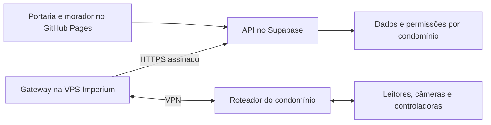

# Imperium · Controle de Acesso

Portaria e área do morador com identidade Imperium, visitas, encomendas, convites temporários, placas, vínculos faciais, reservas e ocorrências.

- [Demonstração](https://horizes.github.io/controle-acesso/)
- [Portaria operacional](https://horizes.github.io/controle-acesso/?ambiente=operacao#portaria)
- [Morador operacional](https://horizes.github.io/controle-acesso/?ambiente=operacao#morador)

O site permanece no GitHub Pages. A API access-api e as tabelas ac_* estão implantadas no projeto Supabase existente. O gateway entregue é um serviço Node.js 24 para uma VPS privada da Imperium, conectado aos equipamentos por VPN. Nenhuma VPS ou equipamento físico foi instalado ou homologado nesta entrega.



## Entradas separadas

A demonstração aceita portaria@imperium.demo, ana@imperium.demo, bruno@imperium.demo e clara@imperium.demo, com senha pública Imperium@2026. Dados fictícios ficam neste navegador. O modo operacional usa exclusivamente Supabase Auth e vínculos em ac_memberships; não aceita contas de exemplo nem recorre à demonstração se a API falhar. Tokens operacionais ficam na memória da página.

O administrador inicial foi vinculado à conta escolhida pelo proprietário. A senha permanece a mesma. Novos usuários precisam de conta confirmada no Supabase Auth e vínculo com o condomínio. O painel não envia mensagens nem altera senhas.

## Integrações entregues

| Fabricante | Código disponível | Etapa física pendente |
| --- | --- | --- |
| Control iD | Login, ação remota e autorização preventiva por callback Pro | Modelo, firmware, portal, rede e contingência |
| Intelbras | Digest/CGI de abertura, stream multipart e ANPR TrafficJunction | Confirmar contratos e campos no modelo |
| Hikvision | Helper C++ HCNetSDK para ControlGateway | Obter SDK oficial, compilar e homologar |
| ZKTeco | Abertura via ZKBio CVSecurity com API licenciada | Servidor, licença, token e porta |
| Dahua | Contrato para ponte licenciada DSS | Implementar ponte com pacote oficial aprovado |

Não representa compatibilidade universal com todos os produtos das marcas. Face é associação do ID identificado pelo leitor a uma credencial; o site não executa reconhecimento facial nem cadastra biometria no equipamento. ANPR implementado: modelos Intelbras com eventos documentados.

Aceite pelo equipamento não confirma posição física do portão. Não há sensor de posição implementado. Timeout após envio fica indeterminado e não causa repetição automática. Equipamentos vêm desativados e sem homologação; o gateway também exige habilitação explícita.

## Instalação e contratos

- [Guia de implantação](./IMPLANTACAO.md)
- [Protocolos e limitações por marca](./INTEGRACOES.md)
- [API e administração](./API.md), [OpenAPI](./public/api/openapi.json)
- [Roteiro de apresentação](./GUIA-DEMONSTRACAO.md)

## Desenvolvimento

Use Node.js 24 ou superior.

```sh
npm ci
npm test
npm run typecheck
npm run typecheck:server
npm run build
npm run build:server
```

No Windows com restrição a fs.realpathSync.native, executar scripts com node --import ./scripts/windows-fs-compat.mjs. Os testes de integração usam equipamentos e autenticação simulados. scripts/check-database.sql valida os RPCs no banco dentro de transação revertida.

docs/ contém o build público do Pages. src/ contém interface; server/ a API; supabase/ migrações e Edge Function; gateway/ o serviço privado, adaptadores, Docker, systemd e modelos WireGuard. .deploy/ é intermediário e não deve ser publicado. Chave de serviço permanece no ambiente do Supabase.
