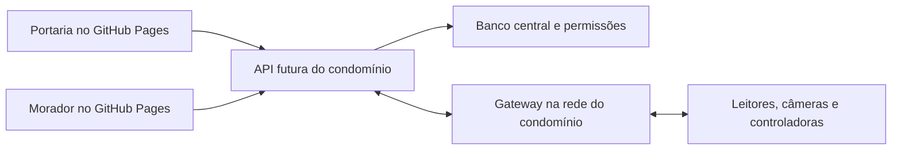

# Imperium · Controle de Acesso

Interface de portaria e morador com a identidade da plataforma Imperium: logo original, Oswald e Barlow, fundo `#0A0A09`, painéis `#15130F` e dourado `#D7B247`.

## Acessos

- [Selecionar acesso](https://horizes.github.io/controle-acesso/)
- [Portaria](https://horizes.github.io/controle-acesso/#portaria)
- [Morador](https://horizes.github.io/controle-acesso/#morador)

As áreas têm telas de entrada separadas. O perfil do morador define a unidade visível. Em cada tela de login, “Acessos de apresentação” mostra as contas fictícias e preenche o formulário.

| Perfil | E-mail público de exemplo | Senha pública de exemplo |
| --- | --- | --- |
| Portaria | `portaria@imperium.demo` | `Imperium@2026` |
| Moradora Ana, 102 Torre A | `ana@imperium.demo` | `Imperium@2026` |
| Morador Bruno, 304 Torre B | `bruno@imperium.demo` | `Imperium@2026` |
| Moradora Clara, 201 Torre A | `clara@imperium.demo` | `Imperium@2026` |

Essas contas são fixtures públicas. Não protegem dados reais. As alterações da apresentação ficam no navegador e podem ser reiniciadas em Configurações na portaria. Portaria e morador compartilham a apresentação somente no mesmo navegador/origem; outra máquina não recebe esses dados sem uma API.

## Funções demonstráveis

Visitas com cadastro, autorização, entrada e saída; encomendas com recebimento e retirada identificada; convites e QR Code com início, término e cancelamento; renovação de autorização aproveitando identificador anterior; conferência simulada de face/placa/código, bloqueio e porta permitida; reservas com verificação de conflito; solicitações e histórico CSV. O morador possui interface responsiva e PWA para adicionar à tela inicial.

## Preparado para API

O site permanece apenas no GitHub Pages. `public/runtime-config.js` permite definir uma API HTTPS compatível. O cliente já inclui login por servidor, token em memória, leitura do estado, comandos de operações e atualização periódica. Sem endereço configurado, usa o modo de apresentação. Não há servidor nem equipamentos conectados nesta publicação.

Veja [API.md](./API.md), [OpenAPI](./public/api/openapi.json) e [integrações por fabricante](./INTEGRACOES.md).



Não colocar credenciais de equipamentos, chaves de serviço ou senhas reais no código público. Consultas preventivas e eventos de auditoria são tratados como finalidades diferentes. A conexão física depende de modelo, firmware, licenças e homologação.

## Desenvolvimento

Use Node.js 24 ou superior.

```sh
npm ci
npm test
npm run typecheck
npm run dev
```

Para atualizar o GitHub Pages:

```sh
npm run build
```

Publique o conteúdo de `docs/` na branch `main`. O Pages está configurado para esse diretório. O build usa caminhos relativos; o service worker atualiza o aplicativo e não intercepta chamadas externas de API nem o arquivo de configuração em tempo de execução.

## Organização

- `src/experience.tsx`: operações e telas dos dois perfis.
- `src/access-entry.tsx` e `src/access-session.ts`: entradas e sessões de apresentação.
- `src/platform.css`: identidade e componentes da plataforma.
- `src/api-client.ts`: autenticação e comandos para a API futura.
- `src/demo-model.ts`: dados fictícios e regras da apresentação.
- `src/access-engine.ts`: avaliação de validade, bloqueio e porta.
- `src/equipment-events.ts`: contrato de gateway, assinatura e observação Control iD.
- `public/api/`: contratos de integração em JSON.
- `scripts/check-demo.mjs`: verificações de regras, sessões e cliente de API.

As verificações de API usam respostas simuladas. Não houve homologação em equipamentos físicos ou teste de notificação real. O uso operacional requer os serviços descritos em API.md e testes no condomínio.
